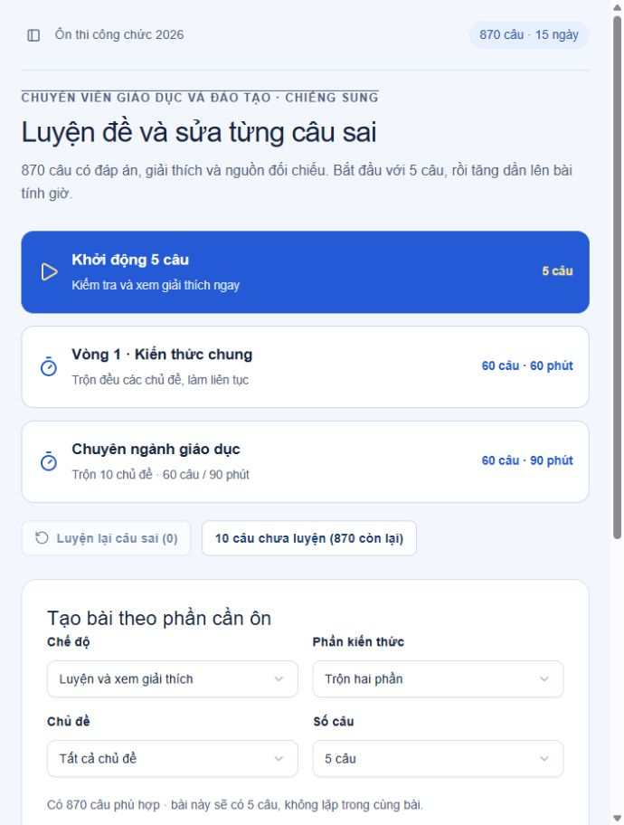

# Ôn thi công chức giáo dục và đào tạo Chiềng Sung

Trang học tiếng Việt dành cho việc ôn tuyển dụng công chức lĩnh vực giáo dục và đào tạo tại xã Chiềng Sung, tỉnh Sơn La. Dự án tập trung vào luyện câu hỏi, làm đề tính giờ, xem căn cứ và sửa lỗi sau mỗi lượt học.

**Dùng ngay:** [Trang luyện đề trên GPT Lab](https://on-thi-giao-duc-chieng-sung.ninicom206.chatgpt.site/).

Không cần đăng nhập. Điểm, câu sai, câu đánh dấu, bài đang làm và tiến độ học được lưu trong trình duyệt của người sử dụng. Dự án không có máy chủ lưu điểm hoặc tài khoản.



## Nội dung hiện có

| Thành phần | Số lượng |
| --- | ---: |
| Chủ đề | 21 |
| Bài học | 119 |
| Bài theo lộ trình chính | 74 |
| Bài đọc bổ sung | 45 |
| Câu kiến thức chung | 390 |
| Câu giáo dục và đào tạo | 480 |
| Tổng câu luyện | 870 |
| Tài liệu gốc | 39 |
| Lộ trình | 15 ngày |

Tài liệu nguồn được đối chiếu ngày **06/10/2026**. Câu hỏi được tự biên soạn theo nguồn, có đáp án, giải thích và viện dẫn điều hoặc mục liên quan. Đây là ngân hàng ôn tập, không phải đề thi chính thức. Có câu trong một nhóm điều không đồng nghĩa đã kiểm tra mọi khoản, ngoại lệ hoặc toàn văn; mục **Phạm vi câu hỏi** giúp truy vết phần đã có câu và phần cần đọc thêm.

## Các chức năng

- Khởi động bằng 5 câu, luyện câu chưa làm, câu đang sai và câu đã đánh dấu.
- Tìm câu hỏi theo nội dung, tên văn bản, số hiệu, điều khoản, nhóm kiến thức, chủ đề và trạng thái.
- Hiện đầy đủ tên văn bản và điều/khoản trước câu hỏi; phần học và giải đáp làm rõ nội dung liên quan, văn bản gốc và bản sửa đổi/đính chính. Đề tính giờ chỉ hiện tên/căn cứ trước khi nộp bài.
- Làm đề kiến thức chung 60 câu/60 phút; luyện giáo dục 60 câu/90 phút; tùy chỉnh số câu và thời gian.
- Phân bố câu trong đề tính giờ giữa các chủ đề, không lặp trong cùng bài.
- Đồng hồ tính theo thời điểm hết hạn và tiếp tục chạy khi rời trang; hết giờ tự chấm các lựa chọn đã có.
- Xem đáp án và giải thích, mở nguồn gốc, luyện lại đúng các câu sai trong bài vừa nộp.
- Theo dõi lịch sử, độ chính xác và kết quả theo chủ đề.
- Đọc bài ngắn, tự nhớ bằng thẻ ôn, ghi chú và đánh dấu phần đã học.
- Chia câu hỏi theo lộ trình 15 ngày, luyện từng chặng 5–10 câu.
- Đọc 39 tệp nguồn, kế hoạch PDF/Word và cẩm nang HTML/Markdown ngay trong dự án.

Vòng 2 trong thông báo quy định 60–120 câu trong 90–180 phút; cấu hình cụ thể do Hội đồng tuyển dụng công bố. Cấu hình 60 câu/90 phút và cách phân bố chủ đề ở đây phục vụ luyện tập.

## Cài đặt và chạy

### Yêu cầu

- Node.js **22.13 trở lên**, kèm npm.
- Chrome, Edge hoặc trình duyệt hiện đại có JavaScript.
- Có mạng khi cài thư viện lần đầu. Các tệp học và tài liệu gốc được giữ trong repository.

### Chạy trong môi trường phát triển

```bash
git clone https://github.com/ninicom/on-thi-giao-duc-chieng-sung.git
cd on-thi-giao-duc-chieng-sung
npm ci
npm run dev
```

Mở địa chỉ Vite hiển thị trong terminal, thường là `http://127.0.0.1:5173/`. Nếu cổng đang được dùng:

```bash
npm run dev -- --port 5175
```

### Tạo bản dùng ngoại tuyến hoặc bản để đưa lên web

```bash
npm run build
```

Kết quả nằm trong `dist/`: một `index.html` chứa sẵn mã JavaScript/CSS và thư mục `downloads/` chứa toàn bộ tài liệu. Mở `dist/index.html` bằng Chrome/Edge hoặc sao chép cả thư mục `dist` lên một dịch vụ phục vụ website tĩnh. Giữ `downloads` đi cùng `index.html` để các liên kết tài liệu hoạt động.

Xem bản đã build qua HTTP:

```bash
npm run preview
```

Mở địa chỉ được in ra, thường là `http://127.0.0.1:4173/`. Dự án không yêu cầu API key, biến môi trường, cơ sở dữ liệu hay dịch vụ đăng nhập. Repository có đầy đủ đầu vào build, không cần thư mục của Codex hoặc các thư mục bên cạnh dự án.

## Các lệnh

| Lệnh | Công dụng |
| --- | --- |
| `npm ci` | Cài đúng các phiên bản trong lockfile |
| `npm run dev` | Chạy Vite để phát triển và xem thay đổi |
| `npm run build` | Tạo website tĩnh trong `dist/` |
| `npm run build:local` | Tên thay thế của lệnh build |
| `npm run preview` | Xem bản trong `dist/` qua HTTP |
| `npm run check` | Kiểm tra TypeScript |
| `npm test` | Kiểm tra dữ liệu, chấm bài và phân bố lịch |
| `npm run test:content` | Kiểm tra cấu trúc nội dung và SHA256 tài liệu nguồn |

GitHub Actions chạy kiểm tra TypeScript, các kiểm tra tự động và build khi có push hoặc pull request.

## Cấu trúc dự án

```text
app/
  main.tsx                 Điểm vào khi chạy Vite
  offline-entry.tsx        Điểm vào của bản HTML tự chứa
  study-client.tsx         Điều hướng và trạng thái học
  engine.ts               Chọn câu, chấm điểm, hết giờ và cập nhật tiến độ
  quiz-panel.tsx           Giao diện làm bài và xem kết quả
  practice-setup.tsx       Chọn đề, bộ lọc và ngân hàng câu hỏi
  lesson-panel.tsx         Bài học, phần tự nhớ và ghi chú
  coverage-view.tsx        Phạm vi câu hỏi theo nguồn
  schedule.ts             Phân bố bài và câu theo 15 ngày
  course.json             Nội dung bài học và toàn bộ câu hỏi
  sources.json            Tên nguồn, URL, đường dẫn và SHA256
  coverage.json           Nhóm quy định và các câu viện dẫn
components/ui/            Các thành phần giao diện sử dụng trong ứng dụng
hooks/                    Hook phục vụ bố cục
lib/                      Hàm hỗ trợ giao diện
public/downloads/
  originals/              39 tệp chính thức giữ nguyên byte nguồn
  Ke-hoach-on-thi-15-ngay.pdf
  Ke-hoach-on-thi-15-ngay.docx
  cam-nang-bai-hoc.html
  cam-nang-bai-hoc.md
  nguon-tai-lieu.json
  pham-vi-cau-hoi.json
scripts/                  Build và kiểm tra tự động
docs/                     Hướng dẫn nội dung và ảnh giao diện
.github/workflows/ci.yml  Kiểm tra tự động trên GitHub
```

Mã dùng React 19, TypeScript, Vite, Tailwind CSS 4, Radix UI, Lucide và Sonner. Bản tĩnh được đóng gói bằng esbuild và PostCSS. Chỉ các thành phần đang phục vụ trang học được giữ; phần thử nghiệm đăng nhập, database và bộ công cụ riêng của môi trường trước không phải đầu vào của bản này.

## Cập nhật nội dung

1. Sửa bài và câu trong `app/course.json`, giữ ID duy nhất và bốn lựa chọn khác nhau. `answer` dùng chỉ số **0–3**, tương ứng A–D.
2. Kiểm tra đáp án với nguồn chính thức, ghi rõ điều/khoản, mốc hiệu lực hoặc trường hợp chuyển tiếp khi cần.
3. Khi thêm nguồn, cập nhật `app/sources.json`, đặt tệp trong `public/downloads/originals/` và ghi SHA256 của tệp.
4. Cập nhật `app/coverage.json` và các bản danh mục trong `public/downloads` để phạm vi viện dẫn khớp câu hỏi.
5. Chạy `npm run check`, `npm test`, rồi `npm run build` trước khi phát hành.

Xem [hướng dẫn cấu trúc dữ liệu và kiểm tra nguồn](docs/CONTENT.md) để biết trường dữ liệu, quy ước và phạm vi kiểm tra.

Kế hoạch PDF/Word và cẩm nang là các bản tài liệu đi kèm tại thời điểm xuất. Build website không tự viết lại những tài liệu này; khi thay đổi nội dung hoặc phân bố câu, cần cập nhật chúng nếu phát hành lại.

## Tiến độ và dữ liệu người học

Tiến độ được lưu tại `localStorage` với khóa `chieng-sung-study-2026`, theo từng trình duyệt và từng địa chỉ website. Mở bản localhost, bản tệp và bản GPT Lab có thể có tiến độ riêng. Xóa dữ liệu website trong trình duyệt sẽ xóa tiến độ ở địa chỉ đó. Repository chỉ chứa mã nguồn và tài liệu học, không chứa kết quả cá nhân đã lưu.

## Nguồn và giới hạn

Nguồn tuyển dụng: [thông báo tuyển dụng công chức Sơn La](https://sonoivu.sonla.gov.vn/thong-tin-tuyen-dung/thong-bao-tuyen-dung-cong-chuc-vao-lam-viec-trong-cac-co-quan-hanh-chinh-cap-tinh-cap-xa-tinh-so-1023923), [danh mục ôn tập](https://sonoivu.sonla.gov.vn/thong-tin-tuyen-dung/thong-bao-so-06-tb-hdtdcc-thong-bao-danh-muc-tai-lieu-on-tap-va-linh-vuc-dang-ky-du-thi-tai-cac--1024823) và [đính chính danh mục](https://sonoivu.sonla.gov.vn/thong-tin-tuyen-dung/hoi-dong-tuyen-dung-cong-chuc-thong-bao-dinh-chinh-mot-so-noi-dung-tai-cac-phu-luc-danh-muc-tai--1025996).

Các URL công bố và URL tải từng văn bản nằm trong `app/sources.json`. Những bản sửa đổi và đính chính cần đọc cùng văn bản gốc. Trước kỳ thi, kiểm tra thông báo mới của Hội đồng và hiệu lực văn bản. Điểm luyện giúp tìm phần cần ôn thêm, không dự báo chắc chắn kết quả thi.

## Góp ý

Khi báo lỗi câu hỏi, ghi ID câu, cách hiểu đang có, điều/khoản hoặc liên kết nguồn và đề xuất sửa. Với thay đổi mã nguồn hoặc dữ liệu, gửi pull request kèm kết quả kiểm tra. Tài liệu chính thức và các thư viện bên thứ ba giữ thông tin nguồn, tác giả và điều kiện sử dụng của chúng.
